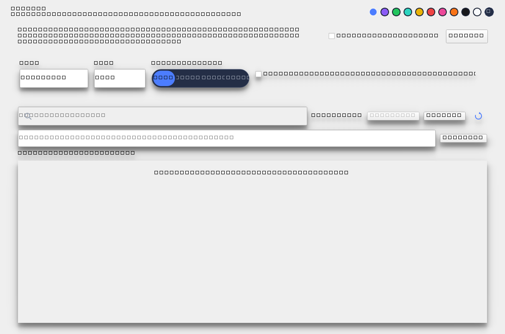

# V-Route

**V-Route** — Windows-приложение для запуска выбранных приложений через уже
работающий локальный прокси (Throne, V2RayN, Hap и другие). Выбираете приложения
из списка — и они ходят в интернет через ваш прокси, а остальные — как обычно.



## Возможности

- 🚀 **Прокси для каждого приложения** — запускает выбранные `.exe` через локальный прокси
- 🔍 **Автосканирование** — находит установленные приложения в меню «Пуск», на рабочем столе и в пользовательских папках
- 🌐 **Поддержка протоколов** — HTTP, HTTPS, SOCKS4, SOCKS5
- 🧩 **Chromium-браузеры** — Chrome, Edge, Brave, Opera, Yandex получают официальный флаг `--proxy-server`
- 🛡️ **Безопасно** — без драйверов, служб, прав администратора и изменения системного прокси
- 🌍 **Глобальный режим** — опционально применяет системный прокси Windows (WinINET) для всех приложений
- 🎨 **Тёмная графитовая тема** с настраиваемым акцентным цветом

## Как это работает

V-Route **не перехватывает** трафик и не устанавливает драйверы (WinDivert/WFP/TUN).
При запуске каждое выбранное приложение получает **отдельное окружение** с
переменными `http_proxy`, `https_proxy`, `all_proxy` и `no_proxy`, указывающими
на ваш локальный прокси. Chromium-браузеры дополнительно запускаются с аргументом
`--proxy-server`. Остановить можно только процессы, запущенные самим V-Route.

> ⚠️ Приложения, которые игнорируют переменные окружения, Chromium-флаги и
> системный прокси, будут обходить его. Для 100 % прозрачного перехвата каждого
> сокета нужен драйвер (WinDivert/WFP/TUN) — V-Route намеренно его не использует.

## Требования

- Windows 10/11 (64-bit)
- Python 3.10+ (только для сборки из исходников)
- Запущенный локальный прокси (например, Throne на `127.0.0.1:2080`)

## Установка

Скачайте последний `V-Route.exe` со страницы
[Releases](https://github.com/R1Sww/V-Route/releases) и запустите — установка не
требуется.

## Сборка из исходников

```bat
build.bat
```

Скрипт установит зависимости, сгенерирует иконку и соберёт `dist\V-Route.exe`
через PyInstaller.

Вручную:

```bat
pip install -r requirements.txt
pyinstaller V-Route.spec
```

## Использование

1. Запустите ваш прокси-клиент (Throne, V2RayN, Hap и т.п.) и убедитесь, что он
   слушает локальный порт (по умолчанию `127.0.0.1:2080`).
2. Откройте V-Route — приложения будут найдены автоматически.
3. Отметьте приложения, которые должны ходить через прокси.
4. Нажмите **Запуск** — выбранные приложения откроются через прокси.
5. Нажмите **Стоп**, чтобы завершить запущенные процессы.

### Глобальный режим

Включите переключатель «Системный прокси для всех приложений» — V-Route применит
системный прокси Windows (WinINET) для текущего пользователя, и трафик
практически всех приложений (включая уже запущенные) пойдёт через локальный
прокси. Права администратора не нужны.

## Настройки

Настройки сохраняются в `%APPDATA%\V-Route\config.json`:

| Поле          | Описание                                   |
|---------------|--------------------------------------------|
| `host`        | Хост прокси (по умолчанию `127.0.0.1`)     |
| `port`        | Порт прокси (по умолчанию `2080`)          |
| `proto`       | Протокол: `HTTP`, `HTTPS`, `SOCKS4`, `SOCKS5` |
| `accent`      | Акцентный цвет темы (hex)                  |
| `selected`    | Список выбранных приложений                |
| `folders`     | Дополнительные папки для сканирования      |
| `manual_apps` | Приложения, добавленные вручную            |

## Проверка

```bat
python main.py --selftest
```

## Структура проекта

```
V-Route/
├── main.py              # точка входа
├── build.bat            # сборка EXE
├── V-Route.spec         # конфигурация PyInstaller
├── requirements.txt
├── vroute/              # исходный код
│   ├── config.py        # настройки
│   ├── engine.py        # запуск/остановка процессов
│   ├── launcher.py      # прокси-окружение и аргументы
│   ├── scanner.py       # поиск установленных приложений
│   ├── mainwindow.py    # главное окно
│   ├── widgets.py       # UI-компоненты
│   ├── theme.py         # тёмная тема
│   └── icons.py         # иконки
├── assets/              # иконка и скриншот
└── tools/               # вспомогательные скрипты
```

## Лицензия

[MIT](LICENSE)
